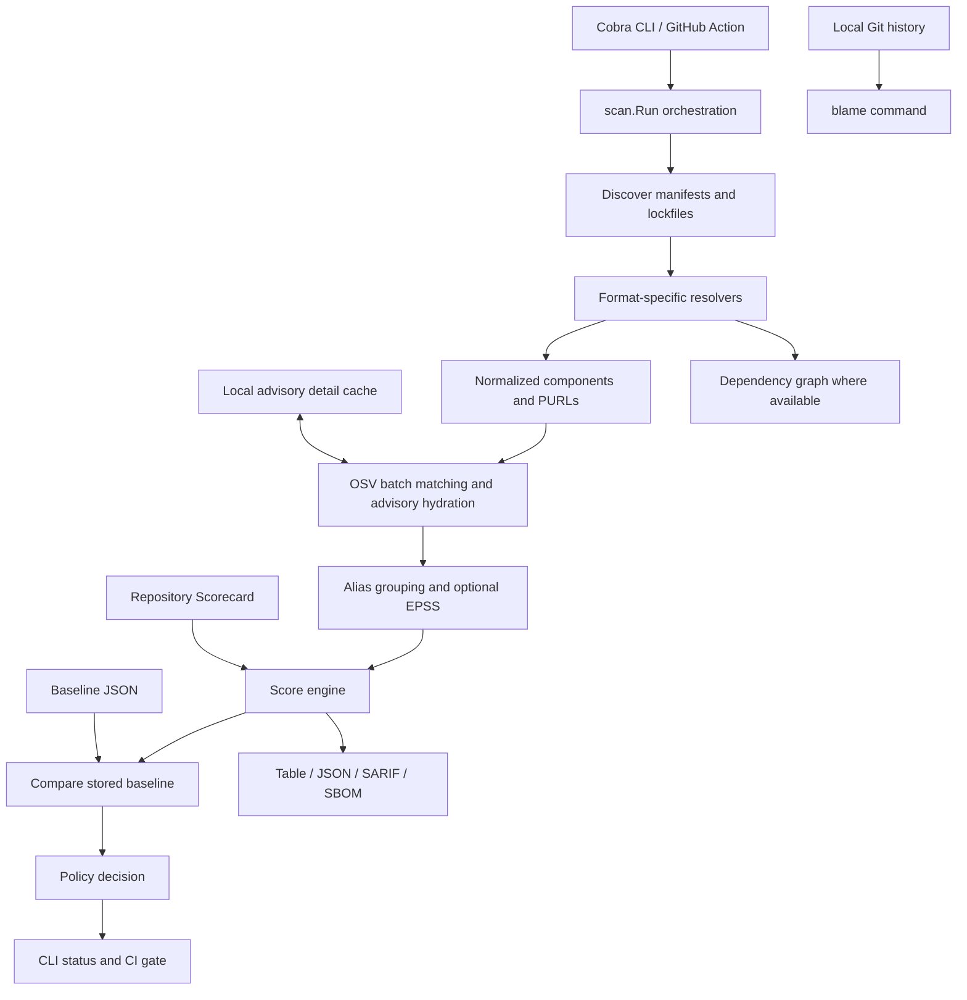

# SCRAM: architecture and interview guide

**Historical snapshot:** This guide describes v0.2.0 and source commit
`1b557a8`, before the subsequent bug fixes. See the
[post-release audit](audits/2026-10-12.md) for corrected behavior.

Prepared 2026-10-12 from the implementation on `main` after the v0.2.0 release. This is a source-based explanation, including implementation gaps; historical design documents sometimes describe intentions that the runtime does not yet fulfill. No runtime code was changed to prepare this guide.

## Contents

1. [The pitch and problem](#1-the-pitch-and-problem)
2. [Vocabulary](#2-vocabulary)
3. [Architecture and stack](#3-architecture-and-stack)
4. [A scan from beginning to end](#4-a-scan-from-beginning-to-end)
5. [Dependency discovery and resolution](#5-dependency-discovery-and-resolution)
6. [Vulnerability lookup and alias deduplication](#6-vulnerability-lookup-and-alias-deduplication)
7. [Caching and external services](#7-caching-and-external-services)
8. [Scoring and its limitations](#8-scoring-and-its-limitations)
9. [Baselines, drift, and policy](#9-baselines-drift-and-policy)
10. [Graphs, blame, and trends](#10-graphs-blame-and-trends)
11. [Reports and SBOMs](#11-reports-and-sboms)
12. [GitHub Action](#12-github-action)
13. [Security and trust boundaries](#13-security-and-trust-boundaries)
14. [Testing and engineering evidence](#14-testing-and-engineering-evidence)
15. [Performance and complexity](#15-performance-and-complexity)
16. [Release engineering](#16-release-engineering)
17. [Known gaps and future work](#17-known-gaps-and-future-work)
18. [Demo and code-reading order](#18-demo-and-code-reading-order)
19. [Interview questions and answers](#19-interview-questions-and-answers)
20. [How to present your contribution](#20-how-to-present-your-contribution)

## 1. The pitch and problem

**One sentence:** SCRAM, Supply Chain Risk Assessment & Monitoring, is a Go CLI and GitHub Action that inventories dependencies, checks known vulnerabilities, explains risk, and compares findings against a baseline so reviewers can focus on changes introduced by a pull request.

**A 60-second explanation:**

> Applications depend on many third-party packages, including packages pulled in indirectly. Security scanners can overwhelm teams with existing vulnerabilities, making every PR look equally bad. SCRAM reads dependency files, normalizes packages into a shared model, queries OSV, merges duplicate advisory identities, and compares the result with a baseline. It generates SBOMs and reports and can fail CI when newly introduced findings cross a policy threshold. It also provides score explanations, dependency paths where the input supports them, and Git history attribution. The current release is v0.2.0. Its main strengths are an explicit pipeline and evidence-driven validation; its major remaining gaps include reachability, complete offline operation, and better score calibration.

**Who needs it?**

| User | Problem | SCRAM's contribution |
|---|---|---|
| Developers and reviewers | Which security findings did this change introduce? | Baseline comparison and a PR summary |
| Application security teams | Existing debt makes blocking adoption difficult | A gate scoped to new findings, with configurable exceptions |
| CI maintainers | Need a repeatable tool and machine-readable artifacts | CLI exit codes, JSON, SARIF, and a composite Action |
| OSS maintainers | Need inventory and context without running a hosted service | Local binary, SBOMs, dependency/history explanations |
| Inventory consumers | Need package identities in a portable document | CycloneDX and SPDX exports |

**Illustrative scenario:** A service already has 80 known findings. A PR adds an old vulnerable package. A baseline-aware check can keep reporting the existing 80 while failing on the new high or critical finding. Updating that package should remove the new advisory from the drift. These are illustrative counts, not adoption or production metrics.

This is dependency analysis. It does not scan application code for SQL injection, identify every malicious package, prove a vulnerable function executes, or automatically fix the application. A clean result means no findings were established under the current inputs and data coverage; it is not proof of safety.

## 2. Vocabulary

| Term | Meaning in this project |
|---|---|
| Direct dependency | A package declared by the project itself |
| Transitive dependency | A package brought in by another dependency |
| Manifest | Declared dependencies, often with version ranges |
| Lockfile | Package manager's recorded resolutions; generally stronger evidence of versions |
| Ecosystem | Registry namespace used in matching: npm, PyPI, Go, or crates.io |
| Package manager | Tool/format such as npm, Yarn, or pnpm; these three share OSV's npm ecosystem |
| PURL | Package URL: a structured package identity, such as `pkg:npm/lodash@4.17.11` |
| CVE / GHSA | Advisory identifiers; two identifiers can describe the same vulnerability |
| CVSS | Severity measure derived from vulnerability characteristics |
| EPSS | Prediction of exploitation in the wild, not application-specific exploitability |
| SBOM | Software Bill of Materials: inventory of software components |
| SARIF | Static Analysis Results Interchange Format, used for security tooling integration |
| Baseline | Stored prior inventory and findings used for comparison |
| Drift | Added/removed packages, changed versions, and changed findings |
| Waiver | Policy exception for an advisory ID, optionally expiring |
| Provenance | Evidence about where an artifact came from and how it was built |

FIRST describes EPSS as a probability of exploitation of a published CVE in the next 30 days. SCRAM consumes that external value; SCRAM does not train or run its own prediction model. See [FIRST's EPSS description](https://www.first.org/epss/).

## 3. Architecture and stack

SCRAM is a **modular monolith implemented as a command-line program**. Its internal packages separate parsing, external data, scoring, comparison, policy, and output. The GitHub Action is an adapter around the released CLI. There is no application server, frontend, persistent SQL database, message broker, or Kubernetes deployment.



The diagram simplifies the code's ordering: EPSS enrichment happens before final alias deduplication, and requested SBOMs are written before drift and policy evaluation. Scoring uses the enriched, deduplicated advisories.

| Technology | Why it is here | Tradeoff |
|---|---|---|
| Go, module directive 1.23.4 | Portable CLI, strong types, standard HTTP/JSON, native concurrency | Format diversity still requires careful handwritten logic |
| Cobra 1.10.2 | Subcommands, help, flags | Exposing a flag does not automatically wire it into the scan engine |
| packageurl-go 0.1.7 | Structured package identities | PURL structure and registry lookup names must remain distinct |
| BurntSushi/toml 1.6.0 | Cargo and Python TOML input | Parsed declarations are not necessarily resolved dependencies |
| yaml.v3 3.0.1 | Policy and YAML formats | Configuration needs semantic validation beyond parsing |
| Standard library | HTTP, context, filesystem, encoding, synchronization, subprocesses | Explicit handling of timeouts, errors, limits, and races |
| Git executable | History inspection for attribution | Local history and Git availability limit the answer |
| Bash + GitHub composite Action | Run the same released binary in CI | Runner permissions and shell portability need validation |
| GoReleaser + cosign | Build, publish, checksum, and sign binaries | Signing alone is not a SLSA build attestation |
| Python tooling | Corpus, differential, and mutation audit scripts | Harness correctness must itself be checked |

Versions above describe the checked-in module, not a recommendation to use those versions in unrelated projects.

**Code map:**

| Location | Responsibility |
|---|---|
| `cmd/scram` | Executable entry point |
| `internal/cli` | Cobra commands, options, output streams, exit behavior |
| `internal/scan` | Pipeline orchestration |
| `internal/detect` | Locate supported input files |
| `internal/resolve` | Parse formats, normalize components, recover some edges |
| `internal/model` | Shared scan/component/vulnerability/score/drift types |
| `internal/vuln` | OSV, hydration, EPSS, alias deduplication, cache |
| `internal/scorecard` | Repository-level OpenSSF Scorecard client |
| `internal/score` | Score terms, presentation, severity buckets |
| `internal/drift` | Baseline persistence and comparison |
| `internal/policy` | Config, exceptions, severity and license gates |
| `internal/graph` | Parent/child indexes and graph traversals |
| `internal/blame` | Git history of dependency changes |
| `internal/trend` | Local score samples and sparkline support |
| `internal/report`, `internal/sbom`, `internal/badge` | Output adapters |
| `action.yml`, `.github/workflows`, `.goreleaser.yml` | Integration, CI, distribution |

## 4. A scan from beginning to end

Start with [scan.Run](../internal/scan/scan.go) and [the CLI scan handler](../internal/cli/scan.go).

1. Resolve the repository path and load its policy.
2. Discover supported projects below that path.
3. Apply ecosystem selection and choose the resolver for each file.
4. Parse files into components, collecting warnings and supported graph edges.
5. Enforce the silent-zero guard: a file declaring dependencies must not quietly produce an empty inventory.
6. Deduplicate normalized components.
7. Unless this is inventory-only mode, query OSV, hydrate advisory details, optionally fetch EPSS, and merge alias-equivalent advisories.
8. Fetch repository Scorecard data when requested or inferred by the CLI from the Git origin, subject to disabling/offline options.
9. Compute component scores and the repository summary.
10. Write requested SBOMs and construct the recovered dependency graph.
11. Load a baseline if supplied, then compute drift.
12. Evaluate severity, waiver, license, and degraded-data policy.
13. Render the report and return an exit status. Human-readable scans can also append local trend history.

The model carries inventory and findings; `scan.Result` separately carries the policy decision, graph, duration, SBOM paths, and maintenance provenance. That separation is useful, but adapters must explicitly propagate those fields; the JSON decision-field gap in section 11 shows what happens when they do not.

## 5. Dependency discovery and resolution

**Four vulnerability ecosystems are implemented:** npm, PyPI, Go, and Cargo/crates.io. Yarn and pnpm are additional npm formats, not additional vulnerability ecosystems.

| Ecosystem | Main supported input families | Important qualification |
|---|---|---|
| npm | package-lock/shrinkwrap, Yarn classic/Berry, pnpm | npm lockfile generations and pnpm layouts differ substantially |
| PyPI | requirements variants, Pipfile.lock, poetry.lock, pyproject.toml fallback | Ranges, markers, optional groups, URLs, and includes complicate completeness |
| Go | go.sum, with go.mod fallback | go.sum records downloaded checksums, not the exact final build graph |
| Cargo | Cargo.lock, with Cargo.toml supplying direct-dependency hints | A bare Cargo.toml is not treated as a resolved lockfile |

Detection uses an ordered preference list: **the first match per ecosystem per directory wins**. It walks to a bounded depth of three and skips directories such as `.git`, `node_modules`, `vendor`, `testdata`, build outputs, virtual environments, and `examples`.

Consequences worth explaining:

- It supports common monorepo layouts, not arbitrary depth or every repository layout.
- Multiple Python requirement files in one directory are not necessarily all merged merely because they are supported filenames.
- A supported parser cannot help if discovery never selects its file. A regression test checks detector/resolver filename agreement.
- Lockfiles are preferred, but even a lockfile can include packages not present in a production deployment. Inventory scope and deployment scope differ.
- Manifest ranges are lower-confidence evidence than exact installed versions. Fallbacks should not be sold as full package-manager resolution.

Resolvers implement a shared interface and register with dispatch logic. Optional interfaces expose warnings and graph edges without forcing every parser to implement capabilities its input cannot support. Adding an ecosystem also requires detector entries, OSV mapping, normalization, fixtures, roundtrip tests, and documentation; one parser file is not the whole integration.

**The silent-zero invariant:** `ResolveFile` independently checks declared dependencies when a resolver returns no components. It produces `ErrSilentZero` instead of letting a nonempty dependency file appear clean. This catches one failure class. It cannot prove every dependency was recovered or that OSV received the right name.

**Identity trap:** Go's OSV key is `github.com/gin-gonic/gin`, not `gin`. A syntactically valid PURL does not prove the outgoing lookup key is correct. Scoped npm names must preserve `@scope/`. This is why the test strategy includes known-vulnerable roundtrips through production lookup code.

## 6. Vulnerability lookup and alias deduplication

See [OSV client](../internal/vuln/osv.go), [hydration](../internal/vuln/hydrate.go), and [deduplication](../internal/vuln/dedupe.go).

**Matching flow:**

1. Convert internal ecosystem names to OSV names: npm, PyPI, Go, crates.io.
2. Send package name, ecosystem, and version to OSV's `/v1/querybatch` endpoint in batches of at most 1,000.
3. Associate each result with its corresponding component.
4. Collect unique advisory IDs and fetch details from `/v1/vulns/{id}` when not cached.
5. Hydrate severity, summary, aliases, affected-range summaries, and advisory links.
6. If enabled, resolve CVE aliases and fetch EPSS in groups of 50, with at most four requests concurrently.
7. Merge alias-connected records for each component.

The main affected-version match is delegated to OSV. SCRAM is not maintaining a complete local vulnerability database or independently reimplementing all ecosystem version-range semantics. OSV documents the batch API [here](https://google.github.io/osv.dev/post-v1-querybatch/).

Hydration permits at most eight concurrent detail requests, uses a mutex around shared result/cache updates, sorts identifiers for stable processing, and limits detail response bodies to 4 MiB. The HTTP client has a timeout and accepts cancellation through contexts.

The CVSS code accepts numeric v3 scores and reconstructs a base score from v3 vectors using local metric/formula helpers. Only recognized `CVSS_V3` severity entries contribute to this path. Do not claim CVSS v4 support or universal standards conformance from this implementation alone.

**Why alias deduplication matters:** One underlying vulnerability can have an OSV record, a GHSA identifier, and a CVE alias. Counting strings overstates distinct advisories.

SCRAM builds connected groups using union-find: records connect if their primary IDs or aliases overlap. A transitive connection also merges the group. It chooses a metadata-rich representative, combines aliases, fills missing information, and preserves paired score/vector metadata. It does not blindly select the largest CVSS number from different source records. Final output is sorted by severity and ID.

The recorded lodash investigation found seven OSV records collapsing into five alias groups for `lodash@4.17.11`, matching SCRAM's five advisories. The differential harness had compared identities incorrectly. Other investigated grype disagreements reflected database coverage differences. This proves those examined cases, not universal superiority over grype.

## 7. Caching and external services

The cache abstraction exposes `Get` and `Set`. Implementations are memory and local files. File entries store key, expiry, stored time, and payload; writes use a temporary file and rename. The default client TTL is six hours. The cache directory can be overridden with `SCRAM_CACHE_DIR`.

**Actual current scope:** Advisory details are cached by advisory ID. The package membership batch query still reaches OSV on ordinary warm-cache scans. The production EPSS path does not currently use the general file cache. Some older prose describes a broader per-component or EPSS cache than the runtime provides.

**Offline caveat:** `QueryOSV` returns an error immediately in offline mode, and scan setup does not use the file cache for that path. Therefore `--offline` is not a working warm-cache vulnerability scan. Inventory-only SBOM generation does not need OSV. Do not promise air-gapped vulnerability scanning today.

**Failure handling:**

- Batch lookup failure is a scan error.
- Detail hydration failure can leave an ID-only finding, emit a warning, and mark the vulnerability scan degraded.
- Degraded vulnerability data fails policy by default unless explicitly allowed.
- Missing Scorecard is not treated as a measured maintenance score of zero; provenance and inapplicable checks are tracked.
- Requested SBOM write failures are collected as warnings by scan orchestration, so successful scan policy alone does not guarantee every requested artifact exists.
- General retry/backoff and fully cached feeds are improvement opportunities.
- EPSS partial failures need careful interpretation; some successful groups can mask failures of other groups in the current enrichment behavior.

## 8. Scoring and its limitations

Read [score.go](../internal/score/score.go). This is an explainable heuristic, not a validated probability of compromise.

| Term | Internal budget | Current calculation/data |
|---|---:|---|
| Severity | 40 | `round(max CVSS / 10 * 40)` |
| Exploitability | 25 | `round(max EPSS * 25)` when enrichment is available |
| Maintenance | 20 | Repository Scorecard aggregate scaled from 0–10 |
| Freshness | 15 | Helper logic exists; normal scan does not populate required version/date maps |

Internal total is the sum, clamped to 0–100. Display conversion is:

```text
presented = clamp((raw_total * 65 + 50) / 100, 0, 65)
```

This is integer rounding of `raw_total * 0.65`. Example: CVSS 9.8 gives severity 39; with the other terms zero, raw total is 39 and the display is **25/65**. The advisory can still be critical and block policy: score presentation is not the sole severity gate.

| Presented score | Component bucket |
|---|---|
| 0 | clean |
| 1–25 | low |
| 26–44 | medium |
| 45–57 | high |
| 58–65 | critical |

Repository numeric score is the maximum presented component score. Repository bucket can also escalate with counts: ten high components can produce a critical repository bucket; 25 medium can produce high; 50 low can produce medium. Findings are not averaged away by adding clean dependencies.

**Candid design issues to know:**

1. Missing input data is not evidence of zero risk. EPSS disabled/unavailable and missing freshness reduce measured contributions.
2. `/65` is a fixed rescaling of the raw formula. It does not dynamically normalize over measured terms, and it does not by itself solve coverage comparability.
3. The maintenance implementation adds more points for a higher Scorecard, even though a higher Scorecard conventionally indicates better practices. Its direction needs review before describing it as a calibrated risk penalty.
4. Maintenance is measured for the scanned repository, then applied to every component. It is not dependency-by-dependency maintenance intelligence.
5. Current freshness maps are empty in the normal pipeline. Do not claim working latest-version tracking or abandonment prediction.
6. Maximum CVSS and maximum EPSS can come from different advisories. The sum is a prioritization heuristic, not a measured joint exploitation probability.

A defensible interview answer is: “The score makes its arithmetic inspectable, while policy preserves advisory severity. The next design step is to represent missingness explicitly, fix maintenance direction, collect dependable inputs, and validate the weighting.”

## 9. Baselines, drift, and policy

[Drift](../internal/drift/drift.go) compares current and prior component sets, reporting added, removed, version-changed, or unchanged dependencies plus new/resolved advisory IDs.

A stored baseline retains historical findings. If a new advisory is disclosed for an unchanged dependency, a later scan can detect it against that stored snapshot. If both base and head are freshly scanned against today's database, unchanged dependencies normally have the same newly published advisory in both scans. These are different operational behaviors.

**Current comparison limitation:** Drift indexes by ecosystem and package name, selecting a version using string ordering when multiple versions exist. It is not a complete multi-version or project-scoped comparison. Lexical ordering is not semantic version ordering. Alias grouping within one scan also does not guarantee a stable representative primary ID across two snapshots.

**Policy behavior:**

- Default threshold is high.
- With a baseline, new finding IDs are the main gate input.
- `fail_on_existing: true` includes existing findings too.
- Without a baseline, default behavior reports vulnerabilities but does not gate them as new. Set `fail_on_existing: true` when all current findings must block.
- Finding severity is the worse of the component bucket and advisory CVSS bucket. CVSS critical starts at 9.0, high at 7.0, medium at 4.0.
- Waivers suppress advisory IDs globally; expiry is optional. Expired waivers can themselves fail policy.
- Denied license strings form an independent gate. This is not a full SPDX expression interpreter or legal conclusion.
- Degraded vulnerability data fails by default unless configured otherwise.

**Configuration pitfalls found by source inspection:**

- The main scan loads `.scram.yml` from the scan root. The global `--config` flag is declared but its path is not used to load an arbitrary file in that path.
- `--fail-on` is applied by the CLI's separate configuration loader used for explanatory output, but the actual `scan.Run` decision does not receive that override. Use the repository's policy file for a dependable threshold until the wiring is fixed.
- Source toggle fields mention OSV/NVD/GHSA, but independent NVD and GHSA clients are not implemented; OSV is the runtime matching source.
- `scram init` writes an ecosystem list with npm/PyPI/Go. Add Cargo or remove the restriction to include it; automatic discovery without that restriction supports Cargo.
- Newness checks use advisory IDs globally, not a fully qualified `(project, package, version, advisory alias-group)` identity.

These are implementation observations, not changes made during this documentation task. They are valuable regression-test targets before broader adoption.

## 10. Graphs, blame, and trends

**`scram why`:** Resolvers can provide parent→child edges. Graph construction resolves endpoints against normalized components, rejects unknown/self edges, and stores both parent and child indexes. `PathTo` uses breadth-first traversal toward a root with a visited set, giving a shortest known path and avoiding cycle hangs. Flat requirements files and go.sum do not establish parentage; absence of an edge is not proof of directness.

There is a current direction issue: `Graph.Dependents` traverses `Children`, so its returned set is descendants/dependencies, despite the “dependents” label. Do not claim this is a correct reverse-impact analysis without addressing the direction. npm install-path nesting is also not a complete representation of all logical package-manager edges, especially hoisting.

**`scram blame`:** Uses local Git commands to examine commits touching a dependency file, reads historical contents, and compares resolved versions. It distinguishes introduction/version change from lockfile churn. The walk is capped at 2,000 commits and reports shallow history. It establishes available Git history, not who caused a vulnerability or whether a version was known unsafe at the time.

**Trend:** Human-readable scan output appends observations to `.scram-trend.json`, with a maximum of 500 points and a display window of 20 samples. One sample does not render a trend. `--no-trend` disables history recording. Trend is a helper package and scan feature; there is no registered standalone `scram trend` command. Changes in vulnerability feeds and enabled options affect scores, so the sparkline is not purely a code-change metric.

## 11. Reports and SBOMs

- Table output is for humans, including drift, policy summary, and optional trend.
- JSON is for automation; human policy text goes to stderr.
- SARIF is an integration format for security tools/GitHub code scanning.
- CycloneDX 1.5 and SPDX 2.3 JSON are generated from the same normalized inventory.
- `scan --explain <PURL-or-unambiguous-name>` shows component arithmetic and available maintenance provenance.
- Badge generation consumes report JSON and emits an SVG.

**Two JSON shapes:** A report contains `{schema_version, scan, drift, passed, ...}`. A baseline has top-level component/summary data. Saving `scan --format json` directly as a baseline is incorrect; use `baseline update`.

**Version distinctions:** Release `v0.2.0`, report schema `2.0.0`, policy configuration version `1`, CycloneDX `1.5`, and SPDX `2.3` are separate version axes. Changing one does not imply changing all of them.

**Known output gaps:** `writeJSON` declares `passed` and `fail_reasons` but does not populate them from `scan.Result.Decision`; `passed` therefore defaults to false. Treat the process exit status/decision as authoritative until that adapter is repaired. SBOM tool metadata also has a hardcoded `0.1.0` constant despite the v0.2.0 CLI release. Neither issue is fixed by binary signatures.

SBOM inventory is only as strong as the resolver's inputs. A component-identity SHA-256 is not a hash of downloaded package bytes. Do not claim artifact integrity verification from an identity hash, or complete deployed-binary composition merely from a source dependency-file inventory.

## 12. GitHub Action

[action.yml](../action.yml) defines a composite Action around the CLI:

1. Determine the requested binary version from the immutable release ref or explicit input.
2. Choose the OS/architecture asset, download it, and verify its published SHA-256 checksum.
3. On PRs, obtain the base ref and materialize it in a separate Git worktree.
4. Use a committed baseline from the base branch when present; otherwise scan the base tree with `baseline update`.
5. Scan the current checkout against that baseline, produce artifacts, and expose summary outputs.
6. Optionally upload SARIF and post/update the PR comment.
7. Preserve the scan's policy failure as the job result.

On push, there is no automatic PR-base comparison; a stored baseline or `fail_on_existing` setting determines vulnerability gate scope. Do not equate a successful push job with “all known vulnerabilities were below threshold.”

The comment step runs after a policy failure when report output exists. D49 fixed the previous behavior where the most useful failing-PR explanation was skipped. User repositories must grant the workflow permissions required for comments/SARIF; fork PR tokens can be restricted. Do not solve permissions by executing untrusted PR code with privileged `pull_request_target` credentials.

The installer verifies checksums; release signatures were verified separately during release validation. Do not claim the Action performs cosign verification unless that step is actually added.

## 13. Security and trust boundaries

**Inputs:** Lockfiles, manifests, policy YAML, baseline JSON, local Git data, remote advisory responses, and the downloaded CLI itself. All deserve validation.

**Data leaving the machine:** Vulnerability queries include dependency names, ecosystems, and versions; detail requests include advisory IDs; EPSS requests include CVEs; Scorecard requests identify a repository. The normal scan does not need to upload application source or package archives. Dependency names can still be sensitive in private repositories.

**Controls present:** Static binary distribution, pinned CI tooling, timeouts, bounded hydration concurrency/body size, cycle guards, history caps, typed model boundaries, fail-closed vulnerability degradation, secret scanning, checksums, and keyless release signatures.

**Limits:** Not every warning fails the scan; resolver failures can be warnings when other projects resolve. “Fail closed” must be described for the specific path, not as a universal guarantee. Default scanning can miss files outside detection scope. File-cache rename helps avoid partial writes but does not prove cross-process locking. A signature proves an expected identity signed bytes; it does not prove the bytes are vulnerability-free or the build environment was uncompromised.

This is why trust needs layered evidence: correct inventory, correct lookup identity, trustworthy external data, correct policy wiring, and verifiable distribution.

## 14. Testing and engineering evidence

See [TESTING.md](../TESTING.md), [CONTRIBUTING.md](../CONTRIBUTING.md), [ADRs](adr/README.md), and [release validation](releases/v0.2.0.md).

| Layer | What it establishes | What it cannot establish alone |
|---|---|---|
| Unit tests | Expected parser/score/policy behavior for selected cases | Real format diversity or complete security coverage |
| Real fixture corpus | Behavior on actual projects and format generations | Correctness for every future input |
| Silent-zero invariant | Declared dependencies cannot quietly produce no inventory | Complete inventory or correct OSV lookup keys |
| PURL/name invariants | Identity shape and consistency | Advisory coverage |
| Known-vulnerable roundtrip | A vulnerable package reaches production lookup correctly | Every advisory/range in every ecosystem |
| Differential testing | Disagreements with another tool become investigation leads | That either tool is automatically ground truth |
| Fuzzing | Input exploration and retained failure seeds | Proof there are no parser/security defects |
| Mutation audit | Tests detect specifically injected wrong behaviors | All possible wrong behaviors |
| Race detector | Races exercised in the tested execution | Absence of every race under all schedules |
| Matrix CI | Selected Go/OS combinations work | Every runner or architecture |
| Release smoke tests | Actual packaged artifacts work in tested workflows | Future releases without revalidation |

Recorded v0.2.0 evidence includes six Go/OS CI matrix legs, coverage/race validation, full-history secret scanning, 22 fuzz targets at 30 seconds each, and 40/40 selected mutations killed. Those are recorded release results, not tests rerun for this guide. Do not call 40/40 a universal mutation coverage percentage.

**Four useful engineering stories:**

- Array-valued npm license metadata caused whole-file decoding to fail and silently erased a large inventory. Fix the input tolerance and test the nonempty invariant.
- Correct-looking Go components were sent to OSV with shortened names. Inventory checks passed while vulnerability matching failed. Add production-path known-vulnerable roundtrips.
- Seven OSV records versus five grype advisories was an alias-group comparison problem. Fix the harness and preserve the reasoning.
- The PR gate failed correctly but skipped its comment. Exercise actual failing PR workflow behavior, then make the report step run after failure without making the gate green.

## 15. Performance and complexity

[BENCHMARKS.md](../BENCHMARKS.md) records machine, toolchain, corpus, and operation scope. Example measurements on Apple M4/darwin-arm64 with Go 1.23.4: 16 npm files resolved in about 125 ms; a 492-component project's SBOM generation took about 30 ms, warm scan 1.3 s, and cold scan 2.81 s. These are historical measurements, not fresh latency guarantees. Network variation is substantial.

**Cost model:** Let N be queried components, D unique uncached advisory IDs, and C distinct CVEs queried for EPSS.

```text
OSV membership requests ≈ ceil(N / 1000)
Detail requests          ≈ D, concurrency capped at 8
EPSS requests           ≈ ceil(C / 50), concurrency capped at 4
Scorecard requests      ≈ 1 when enabled
```

Parsing is generally proportional to input size, plus map operations and sorting. Component sorting is roughly O(N log N). Alias union-find is nearly linear in identifiers/links, followed by output sorting. Graph traversal uses visited sets; the shortest-path implementation copies path slices, so practical cost includes path lengths beyond textbook O(V+E). Some edge deduplication uses linear slice searches. Blame can read many historical file versions and is bounded rather than constant-time.

The main ordinary scan latency comes from network lookup. Full JSON/YAML/TOML decoding also allocates maps and strings; the corpus benchmark's tens of MB are allocations, not automatically leaks. Optimizations should follow profiling: streaming parsers, effective caching, retry budgets, and bounded memory are possible improvements, not proven current bottlenecks everywhere.

## 16. Release engineering

The project is released as [v0.2.0](https://github.com/0xsan7/SCRAM/releases/tag/v0.2.0). See [immutable validation evidence](releases/v0.2.0.md).

- GoReleaser builds Linux amd64/arm64, macOS amd64/arm64, and Windows amd64.
- CGO is disabled; the CLI ships as a standalone binary.
- Version, source commit, and date are injected at link time.
- Build paths/symbol metadata are reduced with configured flags; deterministic-build claims still require matching inputs and reproducibility evidence.
- SHA-256 checksums, keyless cosign signatures/certificates, and both SBOM formats are published.
- Validation checked all binary hashes, exact workflow/tag signing identity, source SHA/build metadata, and native execution through the Action on all five targets.
- Go module proxy installation was also checked.
- Unchanged and new-vulnerability PR cases were exercised, including `/65` comments and comment updates after failure.

**Signing versus SLSA:** Keyless signing uses workflow identity rather than a long-lived signing key. A dedicated build provenance attestation describing build inputs/process remains future work. Do not say “SLSA provenance implemented” based only on the presence of signatures or a source SHA in a certificate.

The stable tag points to its validated source commit; later documentation commits on main do not change that release binary. More roadmap work does not make the completed release unpublished.

## 17. Known gaps and future work

Separate the committed roadmap from improvement priorities inferred from current source.

**Near-term correctness priorities proposed by this guide:**

1. Wire config path and severity flags into the actual decision; add CLI-to-policy integration tests.
2. Populate JSON policy fields from the decision and stamp SBOM tool version from release metadata.
3. Correct graph “dependents” direction and test asymmetric graphs.
4. Preserve multi-version/project identity in drift and use appropriate version semantics.
5. Represent unavailable score data explicitly; review maintenance direction and scoring calibration.
6. Implement real cache-backed offline behavior, meaningful EPSS caching, and partial-failure visibility.
7. Make artifact-generation and partial-parser failures visible enough for consumers to enforce completeness.

**Existing roadmap:**

- SLSA build attestations.
- Reachability analysis using actual code/call-graph information.
- Latest-version/release data per ecosystem and reliable EPSS coverage before restoring a truthful 100-point claim.
- Maven, RubyGems, and .NET. For Maven, obtain resolved/effective dependency data rather than pretending pom.xml alone resolves parent/BOM/version decisions.
- Improve npm v1 dev/optional/peer fidelity.
- Expand CLI coverage and mutation auditing of why/trend paths.
- Abandonment prediction remains deliberately unimplemented.
- A separate documentation site was declined for now.

**Potential product expansion, not an implemented commitment:** Scheduled rescans, organization policy, remediation suggestions, VEX/accepted-risk workflows, and richer evidence export. Each adds scope and a maintenance/security burden; choose based on user demand.

Reachability is especially valuable because a vulnerable dependency's presence does not establish that its affected function is called. Implement it incrementally per language and expose confidence; dynamic dispatch, reflection, generated code, and runtime plugins prevent a universal simple answer.

## 18. Demo and code-reading order

Use a disposable checkout for writes. Commands below are study/demo instructions, not a claim that this documentation task executed them.

```bash
# Identify the binary being discussed.
scram --version

# Inventory only, with no vulnerability service needed.
scram sbom generate . --format both --out /tmp/scram-interview-sbom

# Explore current findings; keep optional Scorecard/trend out of this demo.
scram scan . --no-gate --no-scorecard --no-trend

# Create the correct baseline shape in the disposable checkout.
scram baseline update . --out .scram/baseline.json

# After changing a dependency in that checkout, inspect drift and findings.
scram scan . --baseline .scram/baseline.json --no-scorecard --no-trend

# Machine-readable output; policy explanation stays on stderr.
scram scan . --format json --no-gate --no-scorecard --no-trend > /tmp/scram-interview.json

# Use an actual, unambiguous package/PURL from that scan.
scram scan . --explain '<actual-PURL>' --no-scorecard --no-trend
scram why '<actual-PURL>' --json
scram blame '<actual-PURL>' --json
```

Network-backed commands require working services. Use a rehearsed small fixture with known expected findings; do not rely on the repository itself producing a particular current vulnerability count. Explain that `--no-gate` suppresses policy failure, not arbitrary operational errors.

**Read in this order:**

1. [README](../README.md): user workflow, then compare claims to source.
2. [CLI scan](../internal/cli/scan.go) and [scan orchestration](../internal/scan/scan.go).
3. [Model](../internal/model/model.go), [detector](../internal/detect/detect.go), [resolver contract](../internal/resolve/resolve.go).
4. [npm parser](../internal/resolve/npm.go) and [Go parser](../internal/resolve/golang.go).
5. [OSV](../internal/vuln/osv.go), [hydration](../internal/vuln/hydrate.go), [dedupe](../internal/vuln/dedupe.go).
6. [Score](../internal/score/score.go), [drift](../internal/drift/drift.go), [policy](../internal/policy/policy.go).
7. [Report](../internal/report/report.go), [graph](../internal/graph/graph.go), [Action](../action.yml).
8. [Testing](../TESTING.md), [benchmarks](../BENCHMARKS.md), [release evidence](releases/v0.2.0.md), [roadmap](../ROADMAP.md).

## 19. Interview questions and answers

**1. Why does this project exist when scanners already exist?**
Its focus is an integrated reviewer workflow: inventory, known vulnerabilities, change-based policy, explanations, and Git context in one local CLI/Action. Features overlap other tools. Claim the workflow and implementation evidence, not that nobody else supports baselines or SBOMs.

**2. Why Go?**
A portable executable, standard HTTP/concurrency support, explicit types, and a small runtime dependency surface fit a CLI used on CI runners. Cross-compilation is straightforward with CGO disabled. Portability still requires real platform checks.

**3. Why no database/server?**
The core job runs over a checkout and external advisory APIs. Local files suffice for cache, baseline, and trend. This keeps deployment simple. Organization-wide history/policy would create new storage and access-control requirements.

**4. Are you doing static analysis?**
Static dependency-file analysis, yes; application source vulnerability analysis or function reachability, no. Be precise about that distinction.

**5. How do you find vulnerabilities?**
Normalize package name/ecosystem/version, query OSV in batches, fetch details, enrich CVE-backed findings with optional EPSS, then merge alias groups. OSV performs the main affected-version match.

**6. Why use both CVSS and EPSS?**
They answer different questions: severity characteristics versus predicted exploitation activity. SCRAM consumes both as heuristic inputs; neither establishes this application's actual exposure.

**7. Is the risk score an AI model?**
No. It is explicit arithmetic. EPSS is an external prediction service; SCRAM does not train its model.

**8. Why is the score out of 65?**
The release changed presentation because the original full-data claim was not supported by available inputs. Be exact: current code rescales raw 0–100 arithmetic to 0–65; it is not dynamic normalization and still needs calibration/missing-data improvements.

**9. Can a 25/65 package fail a critical gate?**
Yes. Policy considers the advisory's CVSS severity in addition to the component bucket. A low aggregate contribution must not hide a critical advisory.

**10. What does no baseline mean?**
There is no evidence for new-versus-existing classification. By default findings are reported without gating them as new; `fail_on_existing: true` gates all current findings.

**11. How do you prevent old vulnerability debt blocking every PR?**
Compare against a baseline and gate new findings. Continue displaying existing findings so they do not disappear from view. Maintain a separate remediation process for old debt.

**12. How do you avoid duplicate advisories?**
Union-find connects records sharing IDs/aliases, including transitive links. Merge metadata per group, preserving consistent paired fields. Cross-snapshot canonical identity still needs improvement.

**13. Why not simply compare counts with grype?**
Counts depend on database coverage and identifier grouping. Normalize aliases and inspect package/version evidence before calling a difference a bug. The lodash 7-to-5 case is the concrete example.

**14. What was the most dangerous bug class?**
False-clean scans: empty inventory after parser failure, or a wrong OSV key despite valid-looking components. Separate invariants and known-vulnerable roundtrips address different parts of that chain.

**15. What does the silent-zero guard miss?**
Partially missing inventories, undiscovered files, wrong versions, wrong lookup keys, stale databases, and policy adapter errors. It is one guard, not a correctness proof.

**16. How is concurrency controlled?**
Advisory hydration uses a semaphore with at most eight requests and mutex-protected shared updates. EPSS has a separate cap of four. Bounded concurrency protects service/client resources better than one goroutine per request without a cap.

**17. Is caching enough for offline support?**
Not currently. Membership matching still needs OSV, and offline QueryOSV errors immediately. Real offline support needs a suitable cache/feed, explicit age/completeness handling, and tests for warm/missing/stale cases.

**18. What are the key performance numbers?**
Recorded parser and SBOM work is tens to hundreds of milliseconds on the documented machine; network-backed scans are seconds. State corpus, machine, date, warm/cold state, and that these are historical observations.

**19. How do you test a scanner?**
Layer unit tests, real corpora, invariants, known-vulnerable roundtrips, differential investigation, fuzzing, selected mutations, race detection, and packaged-artifact workflows. Each proves a narrower property.

**20. What is mutation testing useful for?**
Deliberately introduce a wrong behavior and see whether the test fails. A passing suite that survives the mutation was not checking that behavior. The release killed all 40 selected mutations; this says nothing about all unmodeled defects.

**21. Why keep real-world fixtures?**
Handwritten examples inherit assumptions. Actual files expose format generations, arrays/strings where schemas vary, scoped names, hashes, and large dependency graphs.

**22. How do you avoid blaming a developer for a later disclosure?**
Git attribution shows when a version appeared or changed. It does not establish negligence or historical vulnerability knowledge. Report shallow/truncated history explicitly.

**23. Does a dependency path prove reachability?**
No. Package dependency parentage and application function-call reachability are different graphs. Even a correct dependency path does not prove the vulnerable code runs.

**24. What does an SBOM prove?**
It records the inventory SCRAM established from its inputs in a portable format. It does not by itself prove installed/deployed contents, lack of vulnerabilities, or package-byte integrity.

**25. What do signatures prove?**
Expected workflow identity signed particular bytes. Verify issuer, exact identity/tag, and checksums. A signed malicious or incorrectly built artifact is still possible; build attestations add another evidence layer.

**26. What is missing for SLSA provenance?**
A build attestation with verifiable build/source/input details from an appropriate workflow. Current keyless blob signatures are not that full attestation.

**27. How would you add Maven?**
First define trustworthy resolved input, including parent/BOM management and resolution rules. Collect real fixtures and known-vulnerable examples. Then implement detection, resolver, identity mapping, tests, reports, and documentation. Avoid treating declarations alone as the selected dependency graph.

**28. How would you add reachability?**
Start with one language and a defined build context, map advisories to affected symbols, build call/import information, and report confidence. Dynamic features and missing advisory symbol data must remain explicit unknowns.

**29. What would you fix first?**
Policy/config adapter correctness, JSON decision serialization, dependency graph direction, drift identity, and scoring missingness/direction. These improve correctness of existing claims before adding ecosystem breadth.

**30. How do you handle private repository data?**
Explain exactly which package/repository identifiers go to public APIs. Do not claim total offline/privacy isolation. A self-hosted or vendored-data mode would need engineering and explicit configuration.

**31. Is the project complete?**
v0.2.0's authorized release and recorded validation are complete. The product remains an evolving scanner with known limitations and a roadmap. Release completion is not a claim of feature completeness or defect-free software.

**32. How would you measure success?**
Proposed measures: false-clean rate on known-vulnerable fixtures, precision of new-finding classification, inventory completeness, actionable PR findings, latency by cache state, and time to patch. Do not invent adoption, prevention, or revenue metrics.

## 20. How to present your contribution

Use “I implemented” only for work you actually did and can explain. Otherwise say “the project implements” or describe your verified contribution. Be ready to open the relevant code and trace an input through it. Do not memorize claims that conflict with runtime behavior.

**A strong discussion structure:**

1. User problem: existing debt obscures the security effect of a PR.
2. Architecture: shared component model and a sequential pipeline with bounded external I/O.
3. Hard engineering: heterogeneous formats, lookup identities, aliases, and baseline semantics.
4. Evidence: real corpus, known-vulnerable roundtrips, fuzz/mutation audits, actual packaged Action tests.
5. Tradeoff: external APIs simplify matching but constrain privacy, latency, and offline operation.
6. Candor: scoring, configuration adapters, and identity handling have concrete improvement needs.
7. Next step: make existing guarantees reliable, then expand reachability and ecosystem coverage.

**Do not claim:** zero false positives, zero false negatives, complete offline support, independent NVD/GHSA ingestion, a calibrated breach probability, per-dependency maintenance intelligence, implemented abandonment prediction, universal graph parentage, a correct current reverse-dependent traversal, SLSA build attestation, or production adoption numbers that have not been measured.

**Night-before checklist:** Deliver the 60-second pitch without jargon; draw the pipeline; explain one package-to-OSV roundtrip; work the 9.8→39→25/65 example; explain why it can still fail policy; distinguish baseline/report JSON; tell two real bug stories; explain release signatures versus build provenance; name three limitations and a realistic next implementation step.
